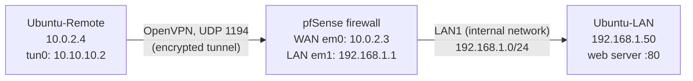

# Remote-Access VPN Lab: pfSense + OpenVPN (VirtualBox)

A fully virtual home lab that simulates a small office network with a firewall and a remote worker connecting in over an encrypted OpenVPN tunnel. Access is restricted using least-privilege firewall rules, and the encryption is verified with packet captures.

**Author:** Adam Diamantidis, Computer Networks & Cybersecurity (BSc Hons), ATU Sligo
**Type:** Home lab project (self-directed, no physical hardware required)

---

## What I built

| Component | Role | Network |
|---|---|---|
| **pfSense CE 2.9.2** | Office firewall/router and OpenVPN server | WAN `10.0.2.3` / LAN `192.168.1.1` |
| **Ubuntu-LAN** | Internal "office" machine hosting a test web server | `192.168.1.50` (LAN) |
| **Ubuntu-Remote** | Remote worker with OpenVPN client | `10.0.2.4` (WAN side), `10.10.10.2` (tunnel) |

Three address spaces are used:
- **WANNET** (`10.0.2.0/24`): a VirtualBox NAT Network acting as the "internet"
- **LAN1** (`192.168.1.0/24`): a VirtualBox Internal Network acting as the office LAN
- **VPN tunnel** (`10.10.10.0/24`): assigned to VPN clients by pfSense

## Why

Remote access VPNs, firewall rules and access control are everyday work in IT support and infrastructure roles. I built this lab to learn how they fit together by actually configuring and troubleshooting them rather than only reading about them.

## What it demonstrates

1. **Remote-access VPN:** OpenVPN server on pfSense with its own certificate authority, server certificate and a per-user certificate, with certificate and password authentication.
2. **Least-privilege access:** the VPN user can reach only one destination, `192.168.1.50` on TCP port 80. Everything else is denied by default.
3. **Verified encryption:** the same web request captured on the WAN side (unreadable) and the LAN side (readable).
4. **Before/after testing:** the office is unreachable before connecting and reachable only as permitted afterwards.
5. **Troubleshooting:** real problems found and fixed along the way (see [docs/05-troubleshooting.md](docs/05-troubleshooting.md)).

## Results summary

| Test | Result |
|---|---|
| Ping office host **before** VPN | Fails (100% loss) |
| VPN connects (`Initialization Sequence Completed`) | Pass; `tun0` = `10.10.10.2/24` |
| Ping `192.168.1.1` and `192.168.1.50` **after** VPN, before restricting | Pass |
| `curl http://192.168.1.50` after least-privilege rule | Pass |
| `ping 192.168.1.50` after rule | Blocked |
| `curl http://192.168.1.50:8080` after rule | Times out |
| `ping 192.168.1.1` after rule | Blocked |
| WAN capture (UDP 1194) | Payload unreadable |
| LAN capture (TCP 80) | HTTP visible in plain text (decrypted inside the office) |

Full evidence with screenshots: [docs/04-testing-and-evidence.md](docs/04-testing-and-evidence.md)

## Documentation

| File | Contents |
|---|---|
| [docs/01-pfsense.md](docs/01-pfsense.md) | pfSense VM, interfaces, DNS, OpenVPN server, user, firewall rules |
| [docs/02-ubuntu-lan.md](docs/02-ubuntu-lan.md) | Internal machine: networking and test web servers |
| [docs/03-ubuntu-remote.md](docs/03-ubuntu-remote.md) | Remote worker: OpenVPN client and connection |
| [docs/04-testing-and-evidence.md](docs/04-testing-and-evidence.md) | Tests, least-privilege proof, packet captures |
| [docs/05-troubleshooting.md](docs/05-troubleshooting.md) | Problems hit and how I resolved them |

## Environment

- Host: Windows PC, Oracle VirtualBox
- Firewall: pfSense CE 2.9.2-RELEASE (amd64)
- Clients: Ubuntu Desktop 26.04
- VPN: OpenVPN (UDP 1194), `openvpn-client-export` package on pfSense
- Tools: `tcpdump`, `ping`, `curl`, `nmcli`, `ip`

## Security notes

- This is an isolated lab. The pfSense web interface uses a self-signed certificate, so the browser warns on first visit.
- Default credentials were changed during setup.
- No passwords, private keys, certificates or `.ovpn` files are committed to this repository (see `.gitignore`).

## What I would do next

- Add a site-to-site IPsec tunnel between two pfSense instances
- Add logging and review of VPN connections in pfSense
- Replace password and certificate login with certificate plus MFA
- Script the Ubuntu client setup
