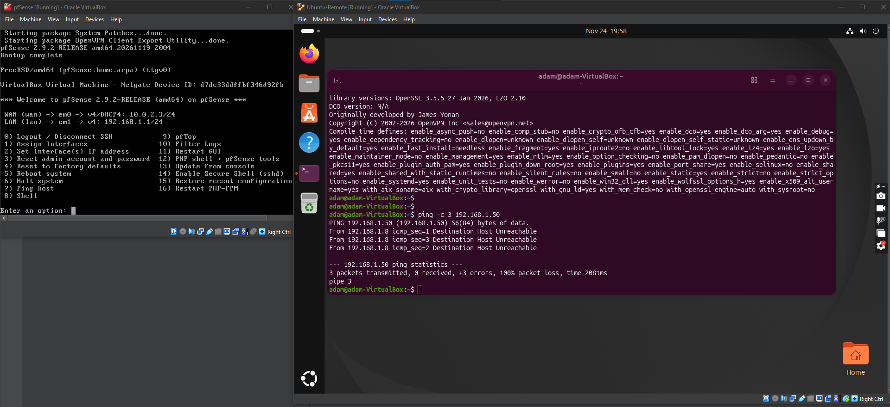
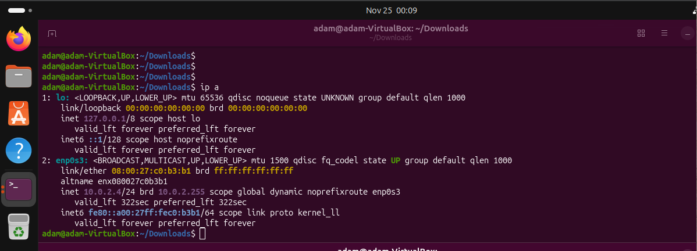
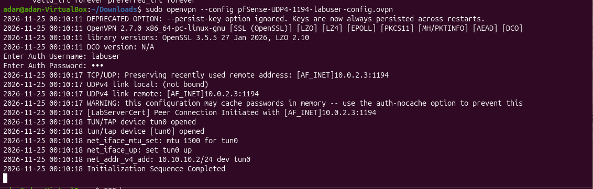
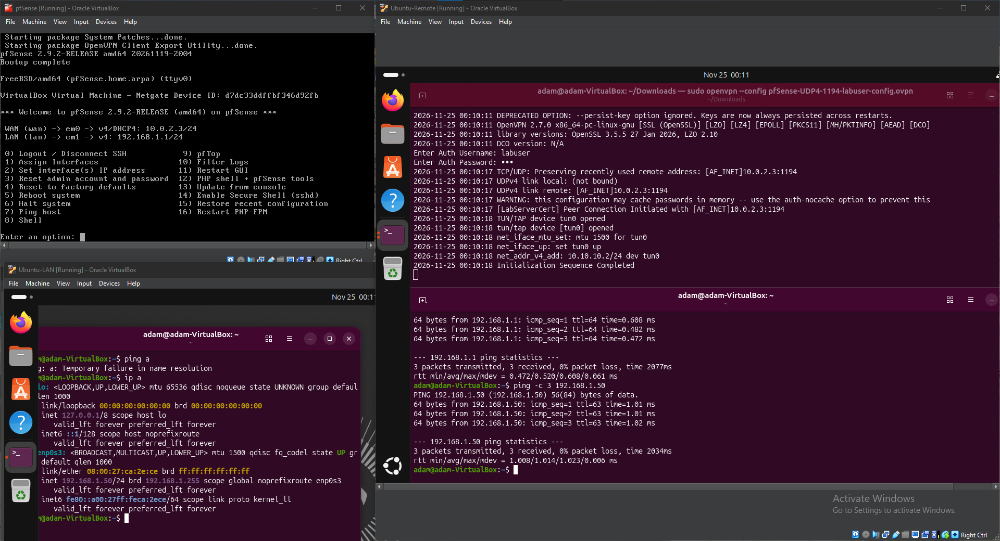
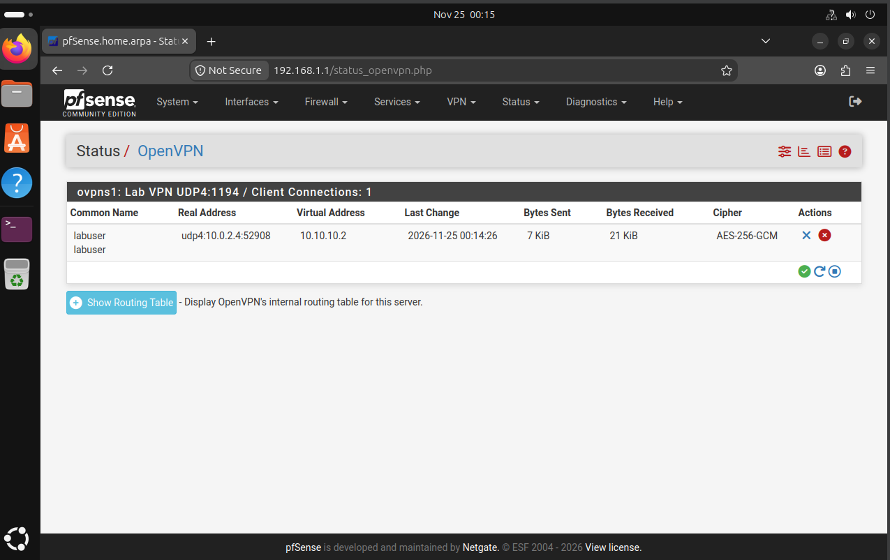
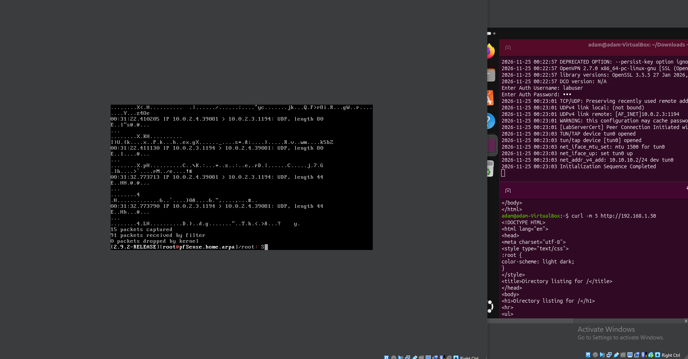
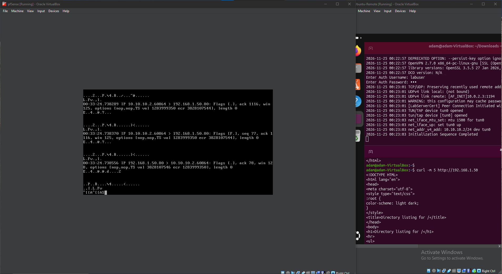

# Screenshots

# Screenshots

Evidence from the lab, in the order the tests were run.

## 1. Before the VPN: the office is unreachable
Ubuntu-Remote pinging 192.168.1.50 before connecting. It fails.

## 2. Remote machine's address before connecting
Ubuntu-Remote sits on the simulated internet with a 10.0.2.4 address.

## 3. VPN connected
The OpenVPN log ends with "Initialization Sequence Completed" and the tunnel address 10.10.10.2/24 on tun0.

## 4. Pings through the tunnel
pfSense, Ubuntu-LAN and Ubuntu-Remote running together. Pings to 192.168.1.1 and 192.168.1.50 now succeed.

## 5. pfSense confirms the session
Status → OpenVPN shows `labuser` connected from 10.0.2.4, tunnel address 10.10.10.2, cipher AES-256-GCM.

## 6. Packet capture on the WAN (encrypted)
`tcpdump` on em0: UDP 1194 between 10.0.2.4 and 10.0.2.3 with a scrambled payload.

## 7. Packet capture on the LAN (decrypted)
`tcpdump` on em1: ordinary TCP between 10.10.10.2 and 192.168.1.50 on port 80, with the inner addresses visible.

